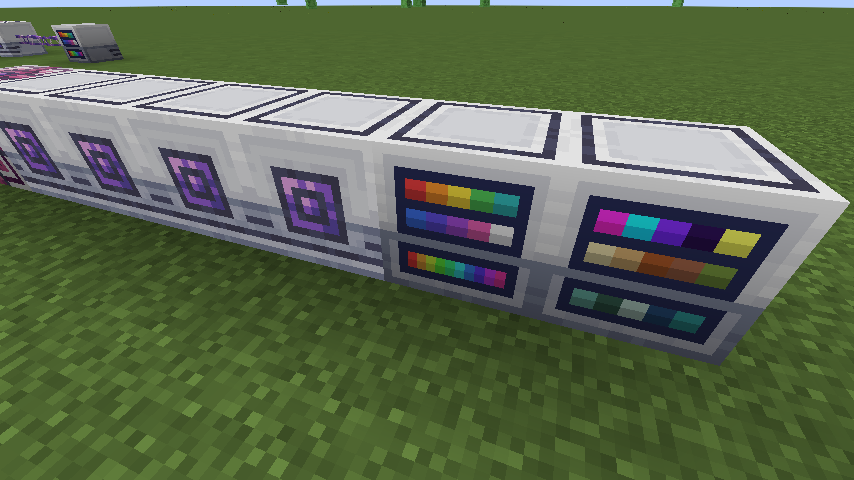
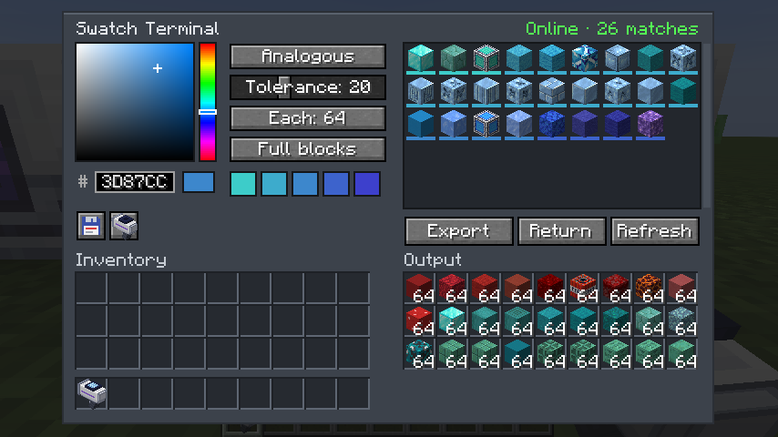
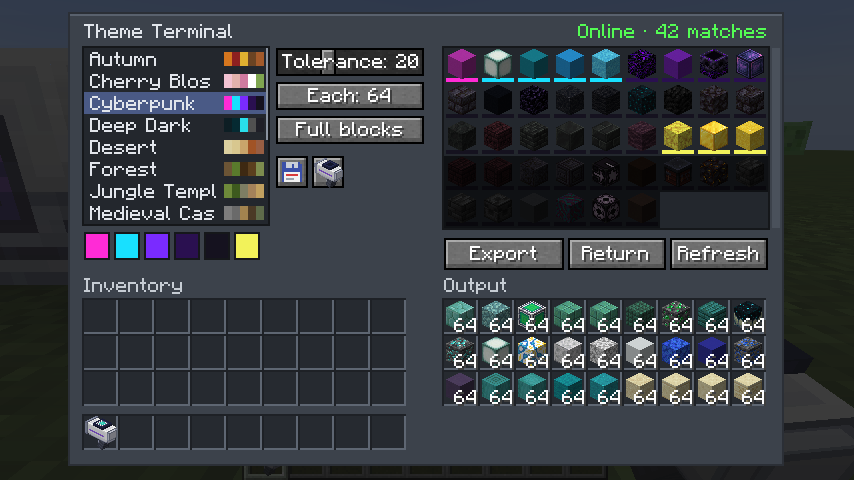
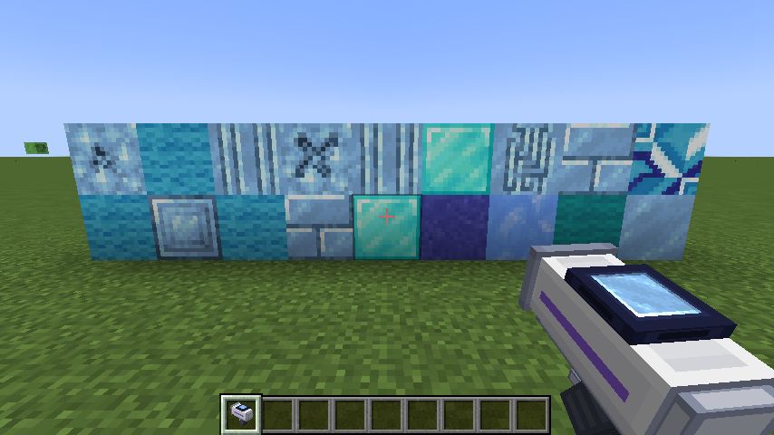
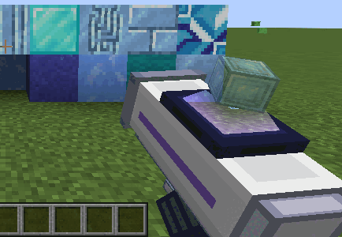

# AppliedSwatches

Applied Energistics 2 addon for NeoForge 1.21.1.



The **Swatch Terminal** joins an ME network (uses one channel) through fluix cables or by touching other AE2 blocks. Pick a colour, pick a scheme, and it lists every block in the network whose texture colour fits the palette. Export pulls a series of them into the terminal's 27 output slots, in palette order.

- Schemes: single, monochrome, analogous, complementary, split complementary, triadic
- Tolerance slider (CIELAB ΔE), amount per block (1 to 64), full blocks only or any shape
- Click a result to skip it; Return puts the output back into the network
- Floppy button: save or load the swatch as a `.json` file, or save it as a theme for the Theme Terminal
- Output slots are exposed to hoppers and pipes
- Block colours are read from each block's model textures on the client, so resource packs change the matches



The **Theme Terminal** works the same way but picks from named themes instead of one colour. It ships with 14: Autumn, Cherry Blossom, Cyberpunk, Deep Dark, Desert, Forest, Jungle Temple, Medieval Castle, Nether, Pastel, Snowy Tundra, Steampunk, The End and Underwater. Its floppy button imports and exports themes as `.json`; imported themes live in `<game dir>/appliedswatches/themes/`. Resource packs can add built-in themes under `assets/<namespace>/themes/`.



The **Swatch Applicator** is a handheld placer. Click the applicator button next to a terminal's floppy button to load the current picks into it; that also links it to the terminal. Right-click places the selected block straight out of the ME network. Its screen shows the selected block, with a spinning hologram of it above.

- Shift + scroll (or Shift + right-click) steps through the palette; past the last block is Random, which places any palette block per click
- Works within 64 blocks of the linked terminal, in the same dimension (configurable)
- Uses the network's power and storage; nothing is kept in the item





Theme format:

```json
{
  "name": "Desert",
  "palette": ["#DBCF9F", "#D8C78F", "#C9A46B", "#A15325"],
  "blocks": ["minecraft:sandstone", "minecraft:terracotta"],
  "tolerance": 18
}
```

`palette` (up to 8 colours) is required. `blocks` are always included when stored, whatever their colour. `tolerance` is optional.

Models: the terminals use AE2's machine casing textures plus a front drawn by `tools/front_texture.py`; the applicator is built by `tools/applicator_model.py`.

Recipes: Swatch Terminal (shapeless) = ME Terminal, Logic Processor, red, green and blue dye. Theme Terminal (shapeless) = Swatch Terminal + book. Swatch Applicator (shaped, like AE2's Color Applicator) = Formation Core, Wireless Receiver, Engineering Processor, 2 iron ingots.

Config (`config/appliedswatches-server.toml`): `swatchTerminalIdlePower` and `themeTerminalIdlePower`, AE per tick, default 2; `applicator.range`, default 64 (0 = anywhere in the dimension).

Requires AE2 19.x.
