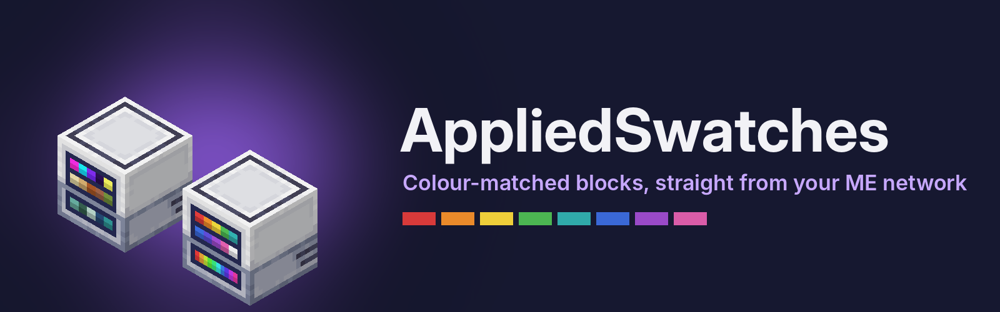
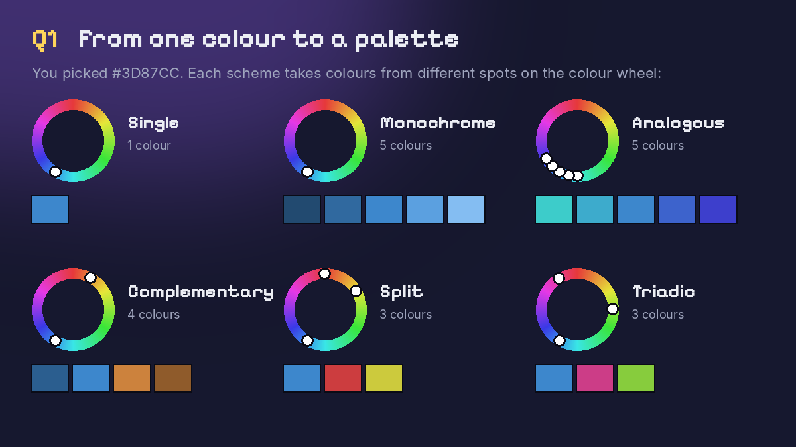
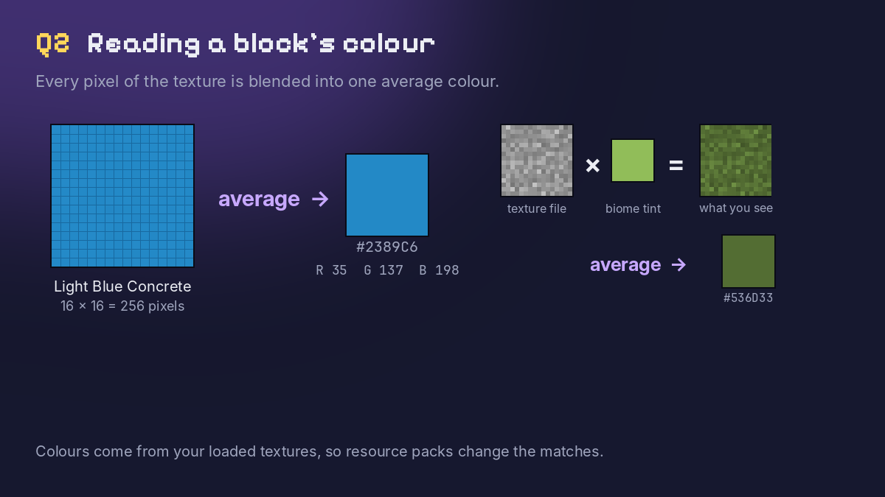
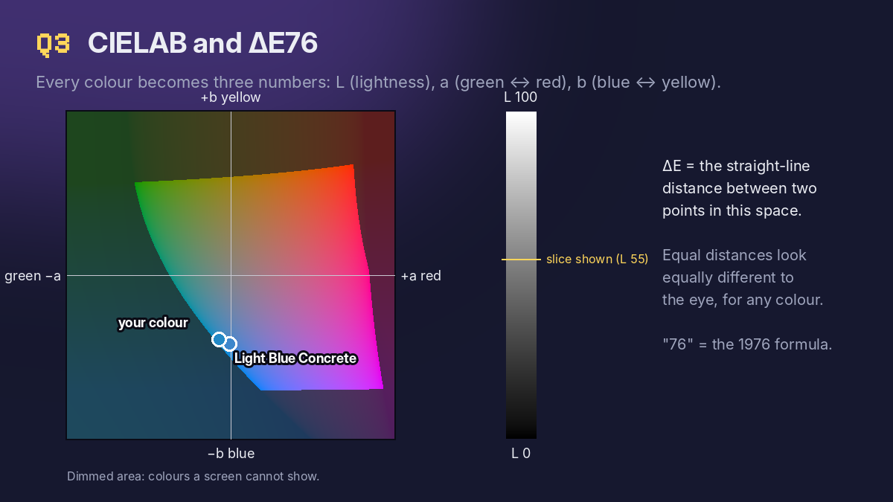
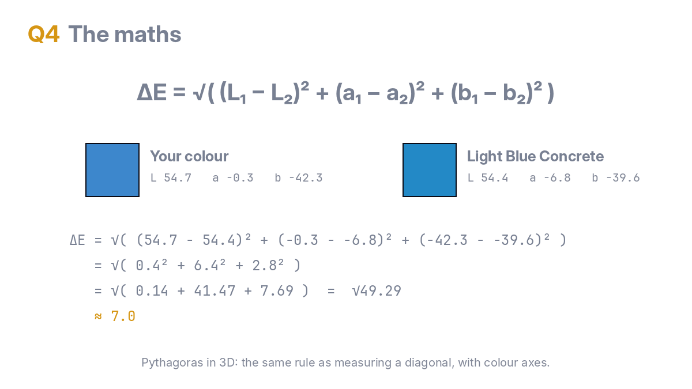
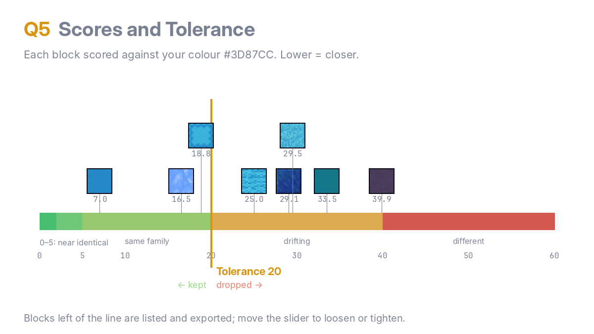
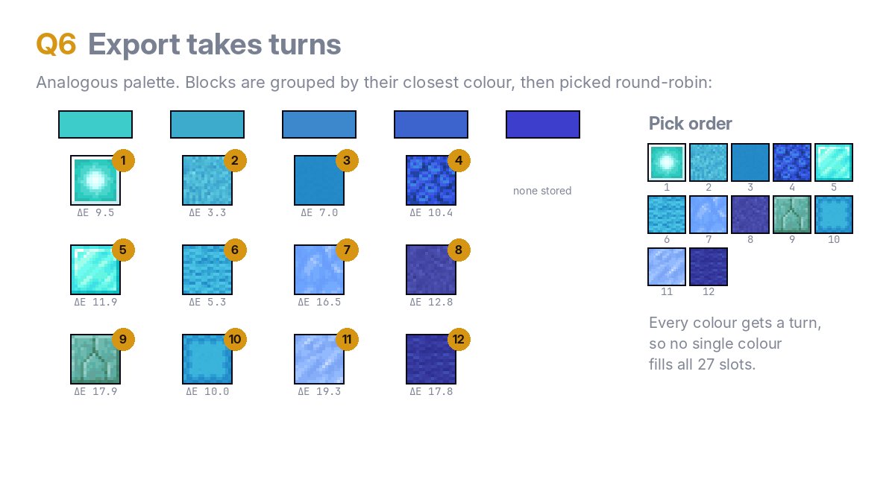
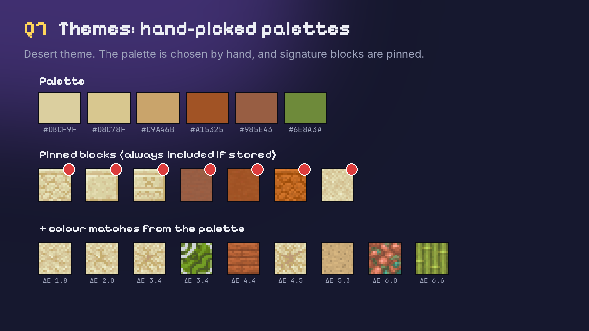

# AppliedSwatches



Applied Energistics 2 addon for NeoForge 1.21.1.


The **Swatch Terminal** joins an ME network (uses one channel) through fluix cables or by touching other AE2 blocks. Pick a colour, pick a scheme, and it lists every block in the network whose texture colour fits the palette. Export pulls a series of them into the terminal's 27 output slots, in palette order.

- Schemes: single, monochrome, analogous, complementary, split complementary, triadic
- Tolerance slider (CIELAB ΔE), amount per block (1 to 64), full blocks only or any shape
- Click a result to skip it; Return puts the output back into the network
- Floppy button: save or load the swatch as a `.json` file, or save it as a theme for the Theme Terminal
- Output slots are exposed to hoppers and pipes
- Block colours are read from each block's model textures on the client, so resource packs change the matches


The **Theme Terminal** works the same way but picks from named themes instead of one colour. It ships with 14: Autumn, Cherry Blossom, Cyberpunk, Deep Dark, Desert, Forest, Jungle Temple, Medieval Castle, Nether, Pastel, Snowy Tundra, Steampunk, The End and Underwater. Its floppy button imports and exports themes as `.json`; imported themes live in `<game dir>/appliedswatches/themes/`. Resource packs can add built-in themes under `assets/<namespace>/themes/`.


The **Swatch Applicator** is a handheld placer. Click the applicator button next to a terminal's floppy button to load the current picks into it; that also links it to the terminal. Right-click places the selected block straight out of the ME network. Its screen shows the selected block, with a spinning hologram of it above.

- Shift + scroll (or Shift + right-click) steps through the palette; past the last block is Random, which places any palette block per click
- Works within 64 blocks of the linked terminal, in the same dimension (configurable)
- Uses the network's power and storage; nothing is kept in the item


Theme format:

```json
{
  "name": "Desert",
  "palette": ["#DBCF9F", "#D8C78F", "#C9A46B", "#A15325"],
  "blocks": ["minecraft:sandstone", "minecraft:terracotta"],
  "tolerance": 18
}
```

`palette` (up to 8 colours) is required. `blocks` are always included when stored, whatever their colour. `tolerance` is optional.

Models: the terminals use AE2's machine casing textures plus a front drawn by `tools/front_texture.py`; the applicator is built by `tools/applicator_model.py`.

Recipes: Swatch Terminal (shapeless) = ME Terminal, Logic Processor, red, green and blue dye. Theme Terminal (shapeless) = Swatch Terminal + book. Swatch Applicator (shaped, like AE2's Color Applicator) = Formation Core, Wireless Receiver, Engineering Processor, 2 iron ingots.

Config (`config/appliedswatches-server.toml`): `swatchTerminalIdlePower` and `themeTerminalIdlePower`, AE per tick, default 2; `applicator.range`, default 64 (0 = anywhere in the dimension).

Requires AE2 19.x.

## FAQ: how blocks are picked

**1. How does a scheme turn my colour into a palette?**
Picture a colour wheel. Single uses only your colour. Monochrome gives five shades of it, from deep to pale. Analogous adds its close neighbours (blue with teal and indigo). Complementary adds the opposite colour (blue and orange). Split adds the two colours beside the opposite. Triadic uses three colours evenly spaced around the wheel. Only Monochrome changes brightness: pick a dark colour and you get dark blocks, pick a pale one and you get pastels.



**2. How does the mod know what colour a block is?**
It reads the block's actual texture, the pixels you see in game, and blends them into one average colour. Grass and leaves get their in-game green tint first, and resource packs count, so matches follow what your blocks really look like.



**3. What is CIELAB ΔE76?**
CIELAB is a colour space designed around human eyesight. Each colour gets three values: **L** (lightness), **a** (green to red) and **b** (blue to yellow). Unlike RGB, equal distances in CIELAB look equally different to us, whatever the colour. **ΔE** ("delta E") is the distance between two colours in that space, and **76** names the original 1976 version of the formula. It's the simplest one, straight-line distance, and accurate enough for block textures.



**4. What maths equation is used?**
Colours are converted from RGB to Lab, then compared with the ΔE76 formula (Pythagoras in 3D):

ΔE = √( (L₁ − L₂)² + (a₁ − a₂)² + (b₁ − b₂)² )

Example: a block at (54.4, −6.8, −39.6) against your colour at (54.7, −0.3, −42.3) gives √(0.3² + 6.5² + 2.7²) = √49.03 ≈ **7.0**



**5. What do the scores and the Tolerance slider mean?**
Each block is scored against its closest palette colour, and lower means closer. Roughly: 0–2 is indistinguishable, 2–5 you'd only notice side by side, 5–20 is the same colour family, 20–40 is related but drifting, and 40+ is a different colour. Tolerance is the cut-off. The default of 20 gives a solid family of blocks; 5 gives near-exact matches only, and 40 gives loose, creative picks. In the example above, 7.0 is under 20, so the block matches.



**6. How does Export decide which blocks to send?**
It takes turns: the best block for colour 1, then colour 2, and so on round the palette, then the second-best for each, until all 27 slots are planned. That way every palette colour gets a share, instead of whichever colour you own the most of filling everything. Click any result to mark it with a red ✕ and Export will skip it.



**7. How are themes different?**
A theme's palette is hand-picked rather than generated from one colour, and themes can pin signature blocks, such as sandstone for Desert. Pinned blocks are always included if you have them, whatever their score.


